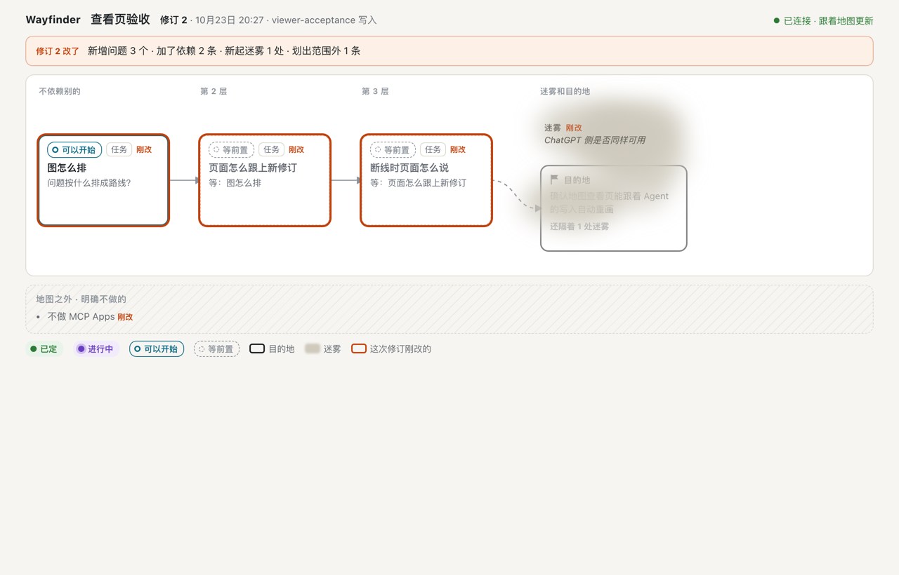
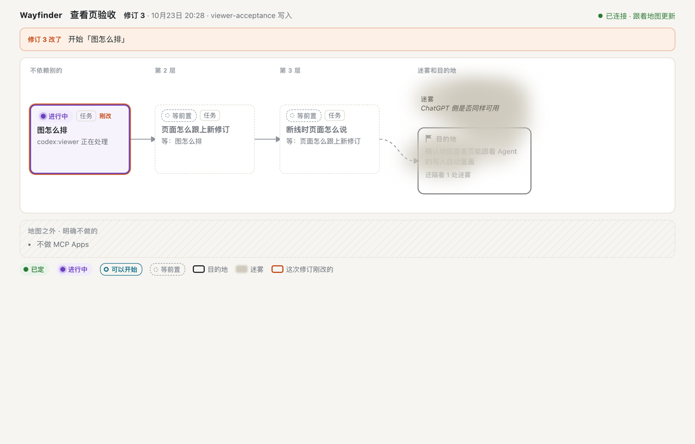
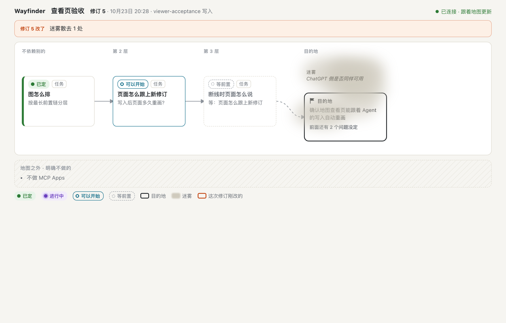
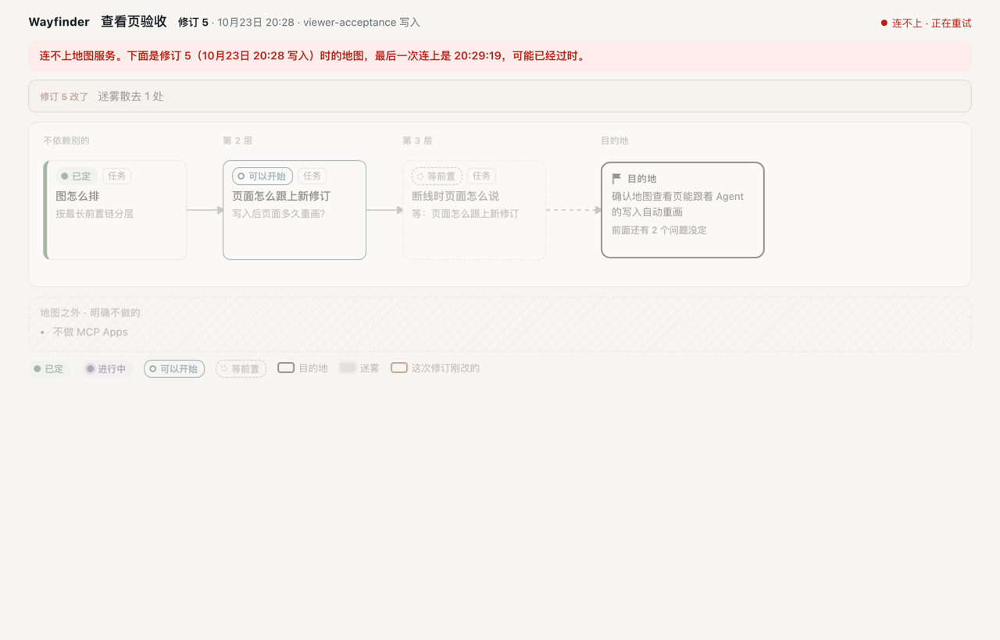

# Local read-only Map viewer

Status: implemented. Automated gates and one installed-Codex journey passed on 2026-10-23. Still open: the live user's own use and verdict, and the ChatGPT check of workflow `2.1.0` at the next live tunnel test.

Requirements and accepted design: [docs/spec/map-viewer.md](../spec/map-viewer.md). The implementation plan and requirement pages were reviewed outside the repository; they are not product Map state.

## Delivered behaviour

- `GET /` lists every Map (all catalog pages). `GET /maps/<mapId>` draws one Map. Both pages are the same static asset; `web/viewer/` holds the page, script and style.
- `GET /api/maps/<mapId>/view?known=<revision>` returns the projection of the latest Revision (`MapView` in `src/viewer-projection.ts`) or 204 while `known` is the latest. `GET /api/maps/<mapId>/history?subject=destination|fog:<id>` serves the details panel only.
- Tickets are laid out by longest prerequisite chain, with the Destination after the last layer and Fog drawn as a cloud in front of it. Scope Exclusions sit outside the Map. The latest Revision's changes are summarized and marked. While following, a new Revision pulses its changed Tickets and fades cleared Fog.
- The page polls every two seconds while visible. When the service is unreachable it keeps the last drawing, greys it and states the Revision, its time and the last successful contact.
- `map_create` and `map_read` results carry `viewerUrl`; `map_apply` results and schema do not. Workflow `2.1.0` tells agents to give the link to the human once on create or resume.

## Access

The MCP host keeps its order: stopping check, exact Host `127.0.0.1:<port>`, then routing by pathname. Only pathname `/mcp` continues to the unchanged token, Origin and MCP handling. Everything else goes to `handleViewer`:

- Methods other than GET and HEAD get 405 with `Allow: GET, HEAD`.
- A page may be opened by a navigation from any site or app (for example a link in Codex or Orca), because it holds no Map data. Scripts, styles and data require no `Origin` or the viewer's own origin, and `Sec-Fetch-Site` absent, `same-origin` or `none` (typed address). Anything else gets 403.
- Every viewer response carries `Content-Security-Policy: default-src 'self'; frame-ancestors 'none'; base-uri 'none'; form-action 'none'`, `Cache-Control: no-store`, `X-Content-Type-Options: nosniff`, `Referrer-Policy: no-referrer` and `Cross-Origin-Resource-Policy: same-origin`. The script builds elements and positions them through CSSOM, so the policy needs no inline styles. All Map text is inserted as text; only `http(s)` References become links.
- Static files come from a fixed list of three names. Errors return fixed codes such as `map_not_found` or `storage_unavailable`, never storage diagnostics.

Accepted local risk: as decided with the plan, the viewer has no key. Any process or macOS user that can reach this Mac's loopback port can read every Map through the viewer while the service runs. Writing still requires the `/mcp` token. The ChatGPT test relay forwards only exactly `/mcp` (`scripts/local-chatgpt-test.mjs`), so the viewer is not reachable through the tunnel. A misconfigured MCP client that posts to `/` now receives the viewer's 405 JSON instead of a JSON-RPC error.

History reads walk Revisions synchronously, so they yield to the event loop every 25 Revisions; a Fog lookup walks back from the head and stops where the item is absent. Polling never reads history.

## Automated evidence

Environment: macOS arm64, Node.js 26.3.0, embedded SQLite 3.53.1, MCP TypeScript SDK 1.30.0.

| Gate | Result |
| --- | --- |
| `tests/viewer-projection.test.ts`: Ticket states against the Frontier, Fog and Scope classification, one Destination change per Revision, route reaching the Destination, empty Map, layering (including a 20,000-Ticket chain without recursion), Destination and Fog history, on Revisions shaped like the real Map `Wayfinder.McpSelfContained` | Pass |
| `tests/viewer-http.test.ts`: real service with disposable SQLite; pages and data need no token while `/mcp` still does; Host, Origin and Sec-Fetch refusals; cross-site navigation allowed only for pages; traversal and unknown paths 404; non-GET 405; HEAD; 204 until a commit, then the new Revision with its changes; input errors; history; `viewerUrl` on create/read only; list across catalog pages; storage fault returns 503 without diagnostics | Pass |
| `tests/mcp-tools.test.ts`: configured viewer origin, refused non-local origins, `map_apply` schema rejects `viewerUrl`, workflow `2.1.0` Resources and Prompt | Pass |
| Existing domain, SQLite, HTTP, admission, shutdown and workflow-build regressions | Pass |

Commands: `npm run --silent typecheck`, `npm run --silent build`, `npm test` (14 files, 1,186 tests), `git diff --check`. Restart comparisons in `tests/mcp-service.test.ts` ignore `viewerUrl`, because the link names the serving port while Map state must stay identical.

## Installed-Codex acceptance

Setup: a consistent SQLite backup of the live user's local database was copied read-only into a new private directory under `~/Library/Application Support/Wayfinder/`; the original database was not opened for writing. The production entry `dist/mcp-start.js` served it on a fixed loopback port with a fresh token. Codex CLI 0.163.0 connected through `mcp_servers.*` with `--ignore-user-config`, a read-only sandbox and only the four Map tools. Headless Chromium kept `/maps/Acceptance.ViewerFollow` open throughout and recorded when the heading showed each new Revision.

1. Before the Map existed the page said so and kept polling. Codex paged the catalog and created the Map; its reply included the viewer link without being asked. (A separate check with the SDK client confirmed that a page opened before `map_create` draws Revision 1 by itself, 2.0 s after the commit.)
2. In the same turn Codex built `ticket.create` with an unsupported `ticketId` field. The service rejected the batch with no Revision; Codex stopped and reported without retrying, as the workflow requires. This is the same command-construction weakness recorded in earlier Codex journeys, not a viewer behaviour.
3. A new Codex session resumed the Map with `map_read`, applied the batch with exact command shapes (Revision 2: three Tickets, two Dependencies, one Fog item, one Scope Exclusion) and again gave the link. The page showed Revision 2 1.5 s after the commit.
4. Resumed sessions claimed `Layout` (Revision 3, shown after 1.7 s), settled it (Revision 4, 0.8 s) and removed the Fog item (Revision 5); the page marked each change, and the Fog faded from in front of the Destination.
5. A fresh session asked to resume read the Map, reported the Frontier and gave the link once.
6. The service was stopped with SIGTERM. The page kept Revision 5, greyed it and said: “连不上地图服务。下面是修订 5（10月23日 20:28 写入）时的地图，最后一次连上是 20:29:19，可能已经过时。” After restart it reconnected by itself. The browser reported no script or policy errors.

| Revision 2 | Revision 3, while following |
| --- | --- |
|  |  |
| **Revision 5, Fog clearing** | **Service stopped** |
|  |  |

## Live user trial

The live user tried the viewer against the acceptance copy with an interactive Codex session.

- Clicking a Ticket, the Destination or Fog rebuilt the drawing, which reset the Map's horizontal scroll to the start. Selection now only restyles the drawing and the details panel. A new Revision still redraws, but keeps the Map's and the page's scroll position. A selected element is scrolled into view only when it is not fully visible.
- On windows about 1,000 px wide the fixed details panel covered the right side of the Map, where Fog and the Destination sit. While the panel is open the page now gives up that width.
- The user asked to see node IDs. Ticket cards, Fog, Scope Exclusions, details, the change summary and the header now show the stable IDs that agents use in tool calls, so the human can name a node in conversation. A long ID is shortened on its card and shown in full on hover and in details. To fit the ID, Ticket cards drop the 「刚改」 text; the orange outline still marks them.

Both were checked in headless Chromium at 1,000 px: four selections, a details-panel link and a new Revision left the scroll position where the reader put it, and every element stayed clickable.

- In portrait windows narrower than 1,000 px the details came after the Map, the Scope Exclusions and the legend, so a selection opened them below the screen. Below 1,000 px they are now a sheet over the lower 45% of the window. The page's end still scrolls above the sheet, a selected element the sheet would hide scrolls into the part left in view, and a new selection starts the details at the top.

The sheet was checked in headless Chromium at 390×844, 820×1180 and 900×1600, and the side panel again at 1280×800: no selected Ticket ended up under the details, and the close button worked with the details scrolled to the end.

## Review

An independent read-only review of the diff found no way for a non-`/mcp` request to reach MCP handling, and no cross-origin read of Map data. It reported and the implementation then fixed: whole-history reads holding the event loop, page selection keys that a Ticket ID such as `dest` could collide with, a failed render that could leave an old Revision labelled current, two `map.update` commands in one Revision both reported as Destination changes, the missing-Map message echoing arbitrary address text, and the shared `map_apply` output schema allowing `viewerUrl`.

## Not delivered here

- The live user's own use of the viewer and verdict.
- ChatGPT acceptance of workflow `2.1.0`; run it at the next `npm run serv` and record the result here.
- `README.md` changes, which wait for the user's pending translation commit.
- MCP Apps, zoom and filtering, older Revisions, sharing, public access and authentication remain out of scope.
